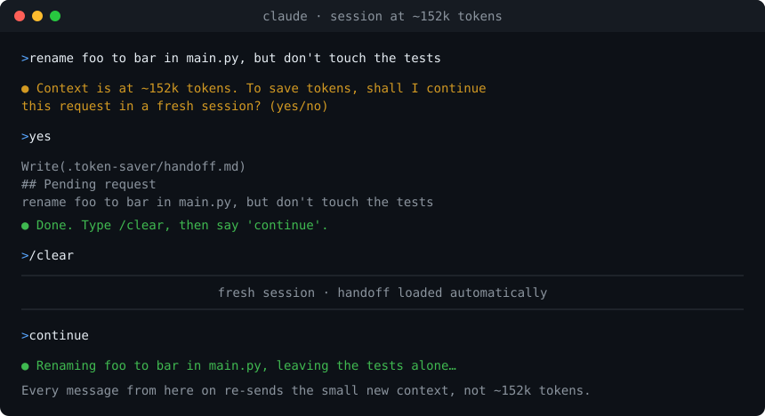

# Token Saver — a Claude Code plugin

[](https://github.com/AbdullahEminEsen/token-saver/actions/workflows/tests.yml)
[](LICENSE)
[](CHANGELOG.md)

Cuts Claude Code token usage automatically. Every message re-sends the whole conversation, so a
600k-token session pays for 600k tokens on every one-line question. Token Saver notices this and
offers to move to a fresh session without losing your place.



<sub>Illustration of the flow. A log of a real run is under [Demo](#demo).</sub>

## Install

In Claude Code (terminal):

```
/plugin marketplace add AbdullahEminEsen/token-saver
/plugin install token-saver@token-saver
```

In the **Claude desktop app (Code tab)**, which has no `/plugin` screen, add this to
`~/.claude/settings.json` and restart the app:

```json
{
  "extraKnownMarketplaces": {
    "token-saver": { "source": { "source": "github", "repo": "AbdullahEminEsen/token-saver" } }
  },
  "enabledPlugins": { "token-saver@token-saver": true }
}
```

Requires Python 3.9 or newer on your `PATH` (`python3` or `python`). No packages to install.

## What it does

| Part | Hook | Effect |
|---|---|---|
| Context guard | `UserPromptSubmit` | When context passes **150k** and **300k** tokens, Claude asks *before* starting your request: "Context is at ~152k tokens. Continue this in a fresh session?" Also asks after a 60+ min break (cold prompt cache). Once per threshold; a threshold re-arms if the context drops back under it (after `/compact`). |
| Handoff skill | — | On "yes", writes `.token-saver/handoff.md` with your goal, changes, decisions, next steps and your **pending request verbatim**. |
| Handoff loader | `SessionStart` | After `/clear`, loads the handoff into the new session. Say "continue" and the pending request runs. Used once. |
| Working rules | `SessionStart` | ~250 tokens of rules: short replies, no re-reading files, narrow exploration, subagents for verbose work, what to keep when compacting. |
| Test filter | `PreToolUse` (Bash) | `php artisan test`, phpunit, pest, npm/pnpm/yarn test, pytest, go test, cargo test: only failures + last lines reach the context. Exit code kept. |

Thresholds are absolute tokens, not percentages: cost depends on how many tokens are in the
context, not on the window size. It also works where the status line doesn't run (desktop app).

## Demo

A real run, Claude Code 2.1.261 on Windows 11. The threshold was lowered with
`TS_WARN_TOKENS=1000` so that a two-message session triggers it:

```
> main.py içindeki foo değişkenini bar yap, ama testlere dokunma!

  Context ~40k token'da. Token'ları tasarruf etmek için bu isteği yeni bir
  session'da devam ettireyim mi? (evet/hayır)

> evet

  Tamam. `/clear` yazın, sonra `continue` deyin.
```

The handoff it wrote, with the request kept word for word:

```markdown
## Pending request
main.py içindeki foo değişkenini bar yap, ama testlere dokunma!

## Decisions and constraints
- Do not modify any test files
- Only change `foo` to `bar` in main.py
```

In the next session, `devam` ("continue") went straight to work on that request, and the handoff
was renamed to `handoff.done.md` so it loads only once. `hook.log` for the run:

```
guard: context ~40k tokens
guard: WARNING shown (~40k tokens)
session-start: startup (…) handoff=yes
```

## Settings

Change them in `/config` (plugin options), or with env vars in `settings.json` → `"env"`:

| Option | Env var | Default |
|---|---|---|
| Warning thresholds | `TS_WARN_TOKENS` | `150000,300000` |
| Idle break (min) | `TS_IDLE_MINUTES` | `60` |
| Smallest context the idle check asks about | `TS_IDLE_MIN_TOKENS` | `60000` |
| Ignore handoffs older than (hours) | `TS_HANDOFF_MAX_AGE_H` | `24` |
| Filter test output | `TS_TEST_FILTER` | `true` |
| Working rules | `TS_INJECT_RULES` | `true` |

Thresholds are plain numbers separated by commas. An entry that can't be read (`150k`) is skipped;
if none can be read, the defaults apply.

## Compatibility

Only setups that have actually been run are marked verified.

| Setup | Status |
|---|---|
| Claude Code CLI 2.1.261, Windows 11, Python 3.12, Git Bash | **Verified** (v1.1.0): question at the threshold, handoff written, next session loads it and continues |
| Hooks on Linux, macOS, Windows with Python 3.9 and 3.13 | **Tested in CI** on every change (hook behavior, without Claude Code itself) |
| Claude desktop app, Code tab | Install steps above; not yet re-verified for v1.1.0 |
| Claude Code CLI on macOS and Linux | Not yet verified — [reports welcome](CONTRIBUTING.md#compatibility-reports) |
| VS Code and JetBrains extensions | Not yet verified |

Setup notes:

- **Terminal:** install with `/plugin`, then check `/hooks` lists three Token Saver hooks.
- **Desktop app:** use the `settings.json` method and restart the app. There is no status line
  there; the guard doesn't need one, because it reads the context size from the session transcript.
- **Windows:** the test filter needs Git Bash, which Claude Code's Bash tool already uses. If only
  `python` (not `python3`) is on your `PATH`, that works too.
- **Permissions:** the handoff is written to `.token-saver/` in your project. In the default
  permission mode you approve that write like any other file edit.

## Check it's working

Each hook writes a line to `~/.claude/plugins/data/token-saver-token-saver/hook.log`
(`/hooks` also lists them in the terminal). To see the question without a long session, set
`TS_WARN_TOKENS` to `1000` for one session: the second message will trigger it.

## Optional: status line (terminal only)

Plugins can't set the status line. To see a context bar, add to `~/.claude/settings.json`:

```json
"statusLine": { "type": "command", "command": "python3 /path/to/token-saver/hooks/statusline.py" }
```

## Notes

- Claude can't run `/clear` itself, so that one keystroke is yours.
- Add `.token-saver/` to `.gitignore` (the handoff skill does this for you).
- Upgrading from 1.0? Handoffs used to go to `.claude/handoff.md`. Claude Code treats `.claude/`
  as sensitive and asks for permission on every write there, so 1.1 writes to `.token-saver/`
  instead. A handoff already sitting in the old place is still picked up.

## Development

```bash
python -m unittest discover -s tests -t tests
```

Standard library only, nothing to install. See [CONTRIBUTING.md](CONTRIBUTING.md) for how the tests
are laid out, [ROADMAP.md](ROADMAP.md) for what's planned, and [CHANGELOG.md](CHANGELOG.md) for
release notes.

---

## Türkçe

Bağlam 150k ve 300k tokeni geçtiğinde Claude, isteğine başlamadan önce "temiz oturumda devam edeyim
mi?" diye sorar. "Evet" dersen bekleyen isteğin de dahil bir handoff dosyası yazar. `/clear` yazıp
"devam" dediğinde kaldığın yerden sürer. Test çıktısını da yalnızca hatalara indirir. Kurulum
yukarıda; Desktop uygulamasında `settings.json` yöntemini kullan.

MIT License.
