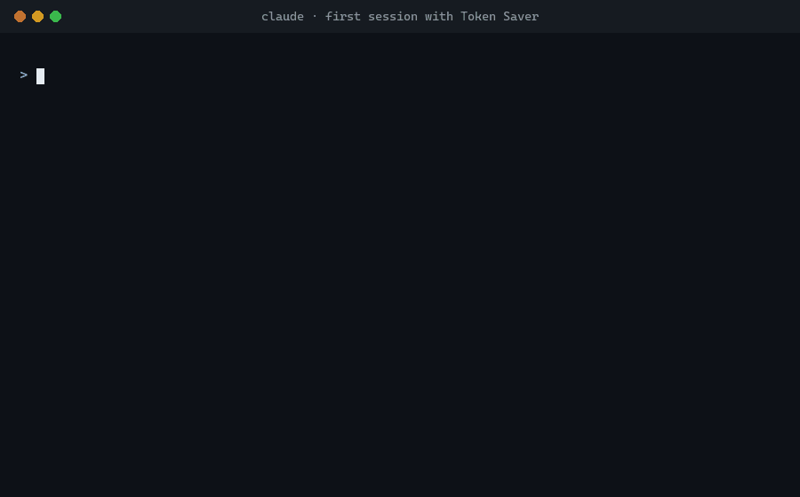

# Token Saver — a Claude Code plugin

[](https://github.com/AbdullahEminEsen/token-saver/actions/workflows/tests.yml)
[](LICENSE)
[](CHANGELOG.md)

Cuts Claude Code token usage automatically. Every message re-sends the whole conversation, so a
600k-token session pays for 600k tokens on every one-line question. Token Saver notices when the
context passes **the size you chose** and offers to move to a fresh session without losing your
place.



<sub>Replay of a real run (Claude Code 2.1.261, Windows 11): the prompts and replies are the actual
text, rendered by [docs/make_demo.py](docs/make_demo.py). It is not a screen capture.</sub>

## Install

In Claude Code (terminal):

```
/plugin marketplace add AbdullahEminEsen/token-saver
/plugin install token-saver@token-saver
```

In the **Claude desktop app (Code tab)**, which has no `/plugin` screen, add this to
`~/.claude/settings.json` and restart the app:

```json
{
  "extraKnownMarketplaces": {
    "token-saver": { "source": { "source": "github", "repo": "AbdullahEminEsen/token-saver" } }
  },
  "enabledPlugins": { "token-saver@token-saver": true }
}
```

Requires Python 3.9 or newer on your `PATH` (`python3` or `python`). No packages to install.

## What it does

| Part | Hook | Effect |
|---|---|---|
| Context guard | `UserPromptSubmit` | When context passes **the token count you chose**, Claude asks *before* starting your request: "Context is at ~152k tokens. Continue this in a fresh session?" Also asks after a 60+ min break (cold prompt cache). Once per threshold; a threshold re-arms if the context drops back under it (after `/compact`). |
| Handoff skill | — | On "yes", writes `.token-saver/handoff.md` with your goal, changes, decisions, next steps and your **pending request verbatim**. |
| Handoff loader | `SessionStart` | After `/clear`, loads the handoff into the new session. Say "continue" and the pending request runs. Used once. |
| Working rules | `SessionStart` | ~250 tokens of rules: short replies, no re-reading files, narrow exploration, subagents for verbose work, what to keep when compacting. |
| Test filter | `PreToolUse` (Bash) | `php artisan test`, phpunit, pest, npm/pnpm/yarn test, pytest, go test, cargo test: only failures + last lines reach the context. Exit code kept. |

Thresholds are absolute tokens, not percentages: cost depends on how many tokens are in the
context, not on the window size. It also works where the status line doesn't run (desktop app).

## Choosing your threshold

Token Saver has no built-in number. The first time you use it, it asks:

```
Token Saver: no notification threshold set yet. Reply with a number such as 100k
(or two, like 150k,300k) to choose when a fresh session is offered, or type: token-saver off
```

Your request still runs. Answer in your next message with just the number (`100k`, `120000`,
`150k, 300k`, `1.5m`) and it is saved for every project. Until you answer, nothing is ever offered,
and the question comes back once per session.

Change it whenever you like by typing one of these in the chat:

| You type | Effect |
|---|---|
| `token-saver 200k` | Notify at 200k tokens |
| `token-saver 150k, 300k` | Notify at 150k, and again at 300k |
| `token-saver off` | Never notify (and stop asking) |
| `token-saver status` | Show the current setting |

If you'd rather set it in configuration, the `warn_tokens` plugin option (asked when you install
from the terminal) or `TS_WARN_TOKENS` does the same and takes priority over the saved answer.

Not sure what to pick? A lower number means cheaper messages but more frequent handoffs. Somewhere
between 100k and 200k suits most work; go higher if you often need a lot of files in view at once.

## Demo

The run shown in the GIF above, as text. Claude Code 2.1.261 on Windows 11; the threshold was
answered as `30k` so that a short session reaches it:

```
> What does main.py print? One line.

  ⓘ Token Saver: no notification threshold set yet. Reply with a number such as 100k …
  It prints `1`.

> 30k

  Got it — I'll offer a fresh session when context hits 30k tokens. You can adjust it
  anytime with `token-saver 200k` or turn it off with `token-saver off`.

> Rename foo to bar in main.py, but keep the print call

  Context is at ~41k tokens. To save tokens, shall I continue this request in a
  fresh session? (yes/no)

> yes

  Done. Type /clear, then say 'continue'.
```

The handoff it wrote keeps the request word for word:

```markdown
## Pending request
Rename foo to bar in main.py, but keep the print call
```

In the next session, `continue` carried the request out (`main.py` now has `bar`), and the handoff
was renamed to `handoff.done.md` so it loads only once. `hook.log` for the run:

```
guard: setup question shown
guard: threshold saved [30000]
guard: context ~41k tokens
guard: WARNING shown (~41k tokens)
session-start: startup (…) handoff=yes
```

The same flow was also run with a Turkish request; the question came back in Turkish and the
request was kept in Turkish in the handoff.

## Settings

Change them in `/config` (plugin options), or with env vars in `settings.json` → `"env"`:

| Option | Env var | Default |
|---|---|---|
| Notify at (tokens) | `TS_WARN_TOKENS` | none: [you choose](#choosing-your-threshold) |
| Idle break (min) | `TS_IDLE_MINUTES` | `60` |
| Smallest context the idle check asks about | `TS_IDLE_MIN_TOKENS` | `60000` |
| Ignore handoffs older than (hours) | `TS_HANDOFF_MAX_AGE_H` | `24` |
| Filter test output | `TS_TEST_FILTER` | `true` |
| Working rules | `TS_INJECT_RULES` | `true` |

Thresholds can be written as `150000`, `150k`, `150.000` or `1.5m`, separated by commas. An entry
that can't be read is skipped; if none can be read, the setting counts as not set and you are asked
in chat instead.

## Compatibility

Only setups that have actually been run are marked verified.

| Setup | Status |
|---|---|
| Claude Code CLI 2.1.261, Windows 11, Python 3.12, Git Bash | **Verified** (v1.1.0): first-run threshold question, answer saved, question at the threshold, handoff written, next session loads it and continues |
| Hooks on Linux, macOS, Windows with Python 3.9 and 3.13 | **Tested in CI** on every change (hook behavior, without Claude Code itself) |
| Claude desktop app, Code tab | Install steps above; not yet re-verified for v1.1.0 |
| Claude Code CLI on macOS and Linux | Not yet verified — [reports welcome](CONTRIBUTING.md#compatibility-reports) |
| VS Code and JetBrains extensions | Not yet verified |

Setup notes:

- **Terminal:** install with `/plugin`, then check `/hooks` lists three Token Saver hooks.
- **Desktop app:** use the `settings.json` method and restart the app. There is no status line
  there; the guard doesn't need one, because it reads the context size from the session transcript.
- **Windows:** the test filter needs Git Bash, which Claude Code's Bash tool already uses. If only
  `python` (not `python3`) is on your `PATH`, that works too.
- **Permissions:** the handoff is written to `.token-saver/` in your project. In the default
  permission mode you approve that write like any other file edit.

## Check it's working

Each hook writes a line to `~/.claude/plugins/data/token-saver-token-saver/hook.log`
(`/hooks` also lists them in the terminal). To see the question without a long session, type
`token-saver 1000`: your next message will trigger it. Then set it back to your real number.

## Optional: status line (terminal only)

Plugins can't set the status line. To see a context bar, add to `~/.claude/settings.json`:

```json
"statusLine": { "type": "command", "command": "python3 /path/to/token-saver/hooks/statusline.py" }
```

## Notes

- Claude can't run `/clear` itself, so that one keystroke is yours.
- Add `.token-saver/` to `.gitignore` (the handoff skill does this for you).
- Upgrading from 1.0? Handoffs used to go to `.claude/handoff.md`. Claude Code treats `.claude/`
  as sensitive and asks for permission on every write there, so 1.1 writes to `.token-saver/`
  instead. A handoff already sitting in the old place is still picked up.

## Development

```bash
python -m unittest discover -s tests -t tests
```

Standard library only, nothing to install. See [CONTRIBUTING.md](CONTRIBUTING.md) for how the tests
are laid out, [ROADMAP.md](ROADMAP.md) for what's planned, and [CHANGELOG.md](CHANGELOG.md) for
release notes.

---

## Türkçe

Sabit bir eşik yoktur: ilk kullanımda Token Saver kaç tokende haber vermesini istediğini sorar,
sen de `100k` gibi bir sayıyla yanıtlarsın. Sonradan sohbete `token-saver 200k` yazarak değiştirir,
`token-saver off` ile kapatırsın. Bağlam senin belirlediğin sayıyı geçtiğinde Claude, isteğine
başlamadan önce "temiz oturumda devam edeyim mi?" diye sorar. "Evet" dersen bekleyen isteğin de dahil bir handoff dosyası yazar. `/clear` yazıp
"devam" dediğinde kaldığın yerden sürer. Test çıktısını da yalnızca hatalara indirir. Kurulum
yukarıda; Desktop uygulamasında `settings.json` yöntemini kullan.

MIT License.
